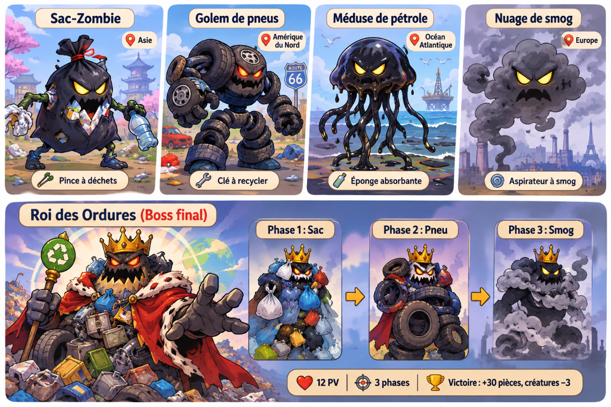
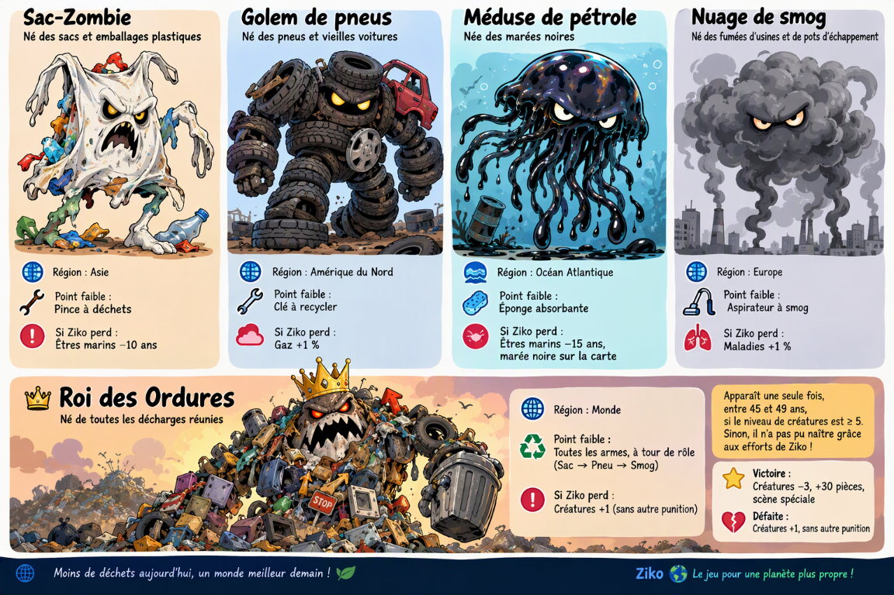

# 12 — Combats

Sur une case ⚔️ **Combat**, une **créature née des déchets** attaque. Trois duels sont jouables : **Sac-Zombie** (case 5, Asie, `/?defi=pince`), **Méduse de pétrole** (case 13, Atlantique, `/?defi=meduse`) et **Golem de pneus** (case 21, Amérique du Nord, `/?defi=golem`). En aperçu, le premier lancer atteint la case et prête son outil pour ce duel, sans modifier l’inventaire.

## Charte commune des duels jouables

Dans chaque arène, les spectateurs encouragent les combattants, légèrement décalés les uns des autres. Ils restent décoratifs, sans collision ni effet sur les commandes.

| Aspect | À conserver pour chaque créature |
|---|---|
| Entrée | Fiche illustrée avant le départ, adaptée au clavier ou au tactile. Le chrono de 40 s attend la confirmation. |
| Décor et personnages | Une arène qui raconte l’origine de la pollution, des spectateurs animés en retrait, une piste lisible. Ziko garde l’apparence de son âge et l’outil de son inventaire. |
| Attaques | Déplacement, saut sans salto, accroupissement, hitboxes et garde frontale temporaire. Un seul bouton : poing → pied → outil si les frappes portent (7/7/14 PV) ; un seul coup de pied directionnel par saut. Un coup reçu efface le combo et les entrées en mémoire. Après le troisième coup, 300 ms sans mémorisation. Pas de soins. |
| Lisibilité | Distinguer anticipation, attaque, impact, récupération et garde par le mouvement et les effets, sans texte d’assistance sous le combat. Chaque spéciale a sa trajectoire et sa réponse, une collision cohérente avec l’animation et un plafond de 25 PV. La garde doit décourager le martèlement sans empêcher de punir une ouverture. |
| Son | Musique originale en boucle, cri ordinaire et appel spécial distincts, bruitages pour impacts, blocages et parade. Respecter la sourdine du plateau et arrêter les sons en quittant la scène. |
| Interface | Jauges RPG vert-or, portraits ronds et chrono central. Clavier : flèches, Espace, Alt et E. Sur téléphone : joystick translucide à gauche, Frappe et Parade à droite, mouvements et actions simultanés. |
| Sortie | Chute du perdant et « KO! » rouge avant le dialogue, jamais de KO sur expiration seule. Illustration de Ziko à gauche du dialogue, adversaire à droite. Victoire : reconnaissance de l’âge et de la détermination, aveu, vœux de succès et 50 % de chances de donner l’un des dix outils équipables. Défaite : moquerie puis promesse de revanche. Bilan et règlement une seule fois, puis plateau jouable. |

### Deuxième rencontre : Méduse de pétrole

Sur le littoral atlantique, cette méduse de goudron se déplace par pulsations. Son tentacule balaie plus loin que le bras du Sac-Zombie : sauter le fouet et la nappe basse, se baisser sous la goutte haute, anticiper sa ruée. Sa spéciale fait bouillonner **trois flaques fixes sur le quai** pendant 1,15 s, puis des jets de pétrole en jaillissent. Un jet enlève 25 PV une seule fois : sauter assez tôt pour le survoler, parer à l’éruption ou quitter la flaque. Le fût rouillé, le bidon cabossé et la bouée goudronnée encouragent la créature en arrière-plan.

L’éponge absorbante allonge la portée du troisième coup contre le pétrole ; la pince n’a pas ce bonus ici. Une défaite enregistre une marée noire dans l’Atlantique et diminue de 15 ans la survie marine ; victoire, nul et défaite conservent le barème du plateau (+8, +2, −5 pièces).

### Troisième rencontre : Golem de pneus

Hors spéciale, le Golem lance de petits pneus à rebonds décroissants (sauter) et des boulons de roue en arc peu prononcé à hauteur de tête (s’accroupir). Il attend 820 ms avant sa prochaine décision et récupère en 440 ms ; sa garde peut se réarmer après 2,05 s. Le temps d’anticipation avant un coup reste inchangé.

Sur la Route 66, les pneus du Golem s’emboîtent pour former une seule roue : son corps devient le projectile. Ce **Double rebond** commence au ras du sol, s’arrête au bord de l’arène sur un choc métallique, puis revient à hauteur de tête. Sauter l’aller, attendre le rebond, puis maintenir ↓ au retour. Chaque passage peut aussi être paré. L’ensemble inflige **au maximum 25 PV**, puis le Golem se déplie à son point de départ et laisse une ouverture. Ce n’est ni une tornade ni une éruption ciblée.

La clé à recycler exploite les jantes et allonge le troisième coup. Le prêt de démonstration ne modifie pas le sac de Ziko. Une défaite augmente les gaz de 1 point ; le dialogue, le don éventuel et le retour au plateau suivent la charte commune.

## Les créatures

Le Sac-Zombie pousse un bref « GRAH ! » au départ de ses attaques ordinaires. Sa tornade est annoncée par un appel original en trois syllabes, « GRA-RA-KA ! ». Ces cris synthétisés respectent la sourdine du plateau. Pendant le duel, les animations et les sons signalent les actions sans commentaire écrit en bas de l’arène.

**Spéciale du Sac-Zombie : tornade de déchets.** La colonne se forme à la position du Sac-Zombie puis avance en ligne droite à vitesse constante. Elle ne suit pas Ziko et poursuit sa route après l’avoir traversé. C’est le passage de son axe sur Ziko qui enlève **25 PV**, une seule fois, sauf si sa parade est active à cet instant. Sauter ou s’accroupir ne protège pas. La prochaine tornade attend au moins sept secondes après la sortie de la précédente.

**Premier combat jouable : case 5, Sac-Zombie.** Pour essayer sa faiblesse sans achat, ouvrir `/?defi=pince`, puis lancer le dé une fois. La pince est prêtée et présélectionnée uniquement pour ce premier combat de démonstration ; l’inventaire normal ne change pas.

### Premier duel : détail des règles et commandes

Avant le départ, la fiche du Sac-Zombie montre six commandes illustrées adaptées au clavier ou à l’écran tactile. « Affronter le Sac-Zombie » ferme la fiche et lance le chronomètre.

Le bandeau de vie reprend le modèle « RPG moderne » : portraits cerclés d’or aux extrémités, PV en chiffres au-dessus des barres vertes brillantes et chrono dans un médaillon central. Chaque barre se vide du centre vers son portrait.

Chaque réplique affiche le personnage en pied, en haut de la case : Ziko à gauche (selon son âge) ou le Sac-Zombie à droite. Les portraits ronds restent réservés aux jauges.

Le Sac-Zombie attend 1,175 s avant sa prochaine décision en marche et récupère en 655 ms. Sa garde peut se réarmer après 2,85 s ; les fenêtres d’anticipation et de parade sont inchangées.

Quand une jauge de vie tombe à zéro, un grand **KO!** rouge en italique apparaît au centre pendant 1,35 s avant le bilan. Il ne s’affiche pas si seul le chrono expire.

Le vaincu tombe et reste au sol. Après le KO, un dialogue au bas de l’arène précède le bilan (Suite / Voir le bilan, Échap pour passer). En cas de victoire, le Sac-Zombie reconnaît les dégâts qu’il a causés et peut remettre un outil : **50 % de chances par victoire**, jamais sur défaite ou match nul. Les dix cadeaux équipables sont : pince à déchets, éponge absorbante, clé à recycler, aspirateur à smog, filet à déchets, brosse à récurer, raclette de voirie, balayette de poche, aimant de collecte et râteau de plage. Le filet conserve aussi son bonus dans Filet Océan.

Le Sac-Zombie défend une décharge au bord du marché. Trois créatures-déchets aux sourcils froncés et aux yeux plissés se déplacent sur les talus, agitent leurs bras pour encourager les combattants et bondissent plus haut quand un coup porte. À l’approche de la tornade, elles se tassent et baissent les bras. Elles ne sont pas des cibles.

Ziko saute sans rotation. Appuyer sur Frappe en l’air déclenche un seul coup de pied, orienté dans le sens du déplacement au déclenchement (ou dans la direction où Ziko regarde s’il saute sur place). Aucun appui en l’air ne prépare de combo : à l’atterrissage, la prochaine frappe repart du poing.

**Animation du premier duel** : au sol, Ziko enfant utilise douze dessins en pied pour le poing, le pied et la pince. Le talon d’appui reste calé entre les poses. Le Sac-Zombie se comprime au contact ; la scène de combat marque un arrêt de 32 ms (72 ms pour le troisième coup), puis le sac recule. Le chrono et la mémoire des frappes restent actifs. Les autres âges, outils et les mouvements aériens gardent leurs animations articulées.

| Commande | Action |
|---|---|
| ← / →, ↑, ↓ | Marcher, sauter, s’accroupir. Les commandes tactiles peuvent être combinées. |
| Espace / Frappe | Un appui par coup. Poing (7 PV), pied (7 PV), puis outil (14 PV). Les impacts ne comptent qu’à portée, pendant la phase active. |
| Alt / Parade | Ziko disparaît 175 ms. Intercepter une attaque pendant cet instant évite les dégâts et laisse une ouverture ; recharge de 1,25 s. |
| E / Outil | Choisir parmi les outils possédés. Aucun soin n’est possible pendant le duel ; aucune trousse n’est consommée. |

Deux appuis supplémentaires au maximum sont mémorisés pendant une animation. Un coup dans le vide ou une pause de plus de 480 ms après récupération ramène au poing. Un coup reçu annule **aussi les appuis mémorisés**. La pince donne plus de portée au troisième coup contre le Sac-Zombie, sans multiplier à nouveau ses dégâts. Le sac avance, prépare une frappe basse (saut) ou une bouteille haute (accroupissement). Une jauge vide décide du KO ; à la fin du chrono sans KO, le sac s’enfuit. Le combat utilise le son du plateau et ne change pas le barème des récompenses.

**Portée de cette version :** les sections de conception ci-dessous décrivant les tours, les cœurs et la barre de timing restent la référence du simulateur historique, pas les commandes du duel jouable.

Après le troisième impact, marteler Frappe entretient la garde frontale du sac sans empêcher ses attaques. Pour créer une ouverture, reculer à plus de 225 unités, ne plus presser Frappe pendant 820 ms, passer derrière ou réussir une parade. Sur ordinateur, aucun bouton virtuel ; sur mobile, joystick gauche (haut : saut, bas : accroupi) et deux boutons ronds translucides à droite. Toucher la ligne de statut permet de changer d’outil.

Le premier Sac-Zombie a 63 PV au lieu de 48 : il faut désormais l’équivalent de neuf coups simples réussis au lieu de six (+50 %), sans raccourcir la fenêtre de parade.

Après la fin du troisième coup, Ziko doit attendre **300 ms** avant de commencer un autre combo. Les appuis sur Frappe pendant le coup d’outil ou cette pause sont ignorés, pas mémorisés. Un nouvel appui après la pause repart au poing. Seules les frappes sont bloquées pendant ces 300 ms.

Le Sac-Zombie peut aussi charger épaule en avant ou faire rouler une bouteille au sol : saute ou utilise la parade, plutôt que de t’accroupir. À courte distance, il peut lever les bras en garde, notamment après avoir encaissé un combo. Pendant 580 ms, sa garde bloque les frappes de face sans perdre de PV ni valider le coup dans la série. Elle ne protège pas son dos. Il baisse ensuite les bras et laisse une ouverture.

| Créature | Née de… | Région (case) | Point faible | Effet si Ziko perd |
|---|---|---|---|---|
| 🛍️ **Sac-Zombie** | Sacs et emballages plastiques | Asie | 🦾 Pince à déchets | Êtres marins −10 ans |
| 🛞 **Golem de pneus** | Pneus et vieilles voitures | Amérique du Nord | 🔧 Clé à recycler | Gaz +1 % |
| 🛢️ **Méduse de pétrole** | Marées noires | Océan Atlantique | 🧴 Éponge absorbante | Êtres marins −15 ans, marée noire sur la carte |
| ☁️ **Nuage de smog** | Fumées d'usines et de pots d'échappement | Europe | 🌀 Aspirateur à smog | Maladies +1 % |
| 👑 **Roi des Ordures** (boss final, facultatif) | Toutes les décharges réunies | Monde | Toutes les armes, à tour de rôle | Voir plus bas |

La **force** d'une créature (ses points de vie, PV) dépend de l'époque **et** du niveau de créatures
dans le Statut :

> **PV** = 3 + n° de l'époque (Enfant = 0, Jeune = 1, Adulte = 2, Super-héros = 3)
> + 1 si le niveau de créatures est ≥ 8 (🔴)

## Apparence des créatures (référence visuelle)



Une deuxième planche, plus proche de **fiches de créatures** (nom, origine, région, point faible, effet
de la défaite), sert de modèle pour les fiches du jeu et pour le style des monstres :



Ces planches servent de **référence officielle** pour l'apparence des créatures. Elle est en accord avec
les noms, les régions, les points faibles et le boss décrits dans ce document.

**Style commun à toutes les créatures** : un corps **sombre** (noir et gris anthracite) fait de
déchets, des **yeux jaunes ou rouges qui brillent**, une bouche en dents de scie et un air méchant mais
**pas trop effrayant** pour des enfants. Un **décor typique de la région** se trouve derrière chaque
créature.

| Créature | Apparence | Décor de combat | Animations à prévoir |
|---|---|---|---|
| 🛍️ **Sac-Zombie** | Un gros sac-poubelle noir et déchiré, fermé par un nœud rouge. Des déchets sortent de sa bouche. Il a des bras de zombie verts et tient une bouteille en plastique. | Asie : pagodes, cerisiers en fleurs, déchets au sol | Il marche en traînant les pieds, lance des bouteilles, et se dégonfle quand il est vaincu |
| 🛞 **Golem de pneus** | Un géant fait de pneus empilés, avec des jantes en guise d'épaules et des yeux rouges. Il est massif et lent. | Amérique du Nord : panneau « Route 66 », voitures abandonnées | Il frappe le sol (l'écran tremble), roule sur lui-même, puis s'écroule en pneus qui rebondissent |
| 🛢️ **Méduse de pétrole** | Une méduse luisante de pétrole noir, avec de longs tentacules qui dégoulinent. | Océan Atlantique : plateforme pétrolière, mouettes, plage tachée | Elle flotte et ondule, projette des gouttes de pétrole, puis fond en flaque que l'éponge absorbe |
| ☁️ **Nuage de smog** | Un nuage de fumée gris foncé, sans contour net, avec des yeux jaunes en colère. | Europe : cheminées d'usines, silhouette de ville avec la tour Eiffel | Il se gonfle, souffle de la fumée qui cache une partie de la barre de timing, puis se fait aspirer en spirale |
| 👑 **Roi des Ordures** | Un monstre géant de déchets mélangés, avec une couronne dorée, une cape rouge à bordure d'hermine et un sceptre avec le logo du recyclage (qu'il a volé). Il est assis sur un trône de déchets. | Une décharge géante, avec la Terre en arrière-plan | Voir les 3 phases ci-dessous |

**Boss final : apparence des 3 phases** (avec un fondu entre chaque phase) :

| Phase | Apparence | Point faible |
|---|---|---|
| 1 — **Sac** | Son corps est fait de sacs plastiques de toutes les couleurs | 🦾 Pince à déchets |
| 2 — **Pneu** | Il se reconstruit en pneus, et sa cape est en partie arrachée | 🔧 Clé à recycler |
| 3 — **Smog** | Il devient un nuage noir, seuls sa couronne et ses yeux restent visibles | 🌀 Aspirateur à smog |

Les bandeaux de l'image (nom, région, point faible, et « 12 PV · 3 phases · Victoire : +30 pièces,
créatures −3 ») servent aussi de **modèle pour la fiche de la créature**. Cette fiche s'affiche avant
chaque combat et quand on clique sur un point 👹 de la [carte](09-carte-du-monde.md).

**À produire pour le jeu** : pour chaque créature, une feuille de sprites (au repos, attaque, coup reçu,
défaite) et son décor de combat. Pour le boss : 3 versions, une par phase, plus son apparition et sa
défaite.

## Style visuel : un RPG rétro « 32 bits »

Les combats ressemblent à un **jeu de rôle rétro au tour par tour**, avec un rendu de **l'ère 32 bits**
(PlayStation 1, Saturn, Game Boy Advance). C'est du pixel art **détaillé**, assez fin pour bien voir les
détails des monstres et du boss : couronne, cape, sceptre, déchets qui composent leur corps.

| Élément | Règle |
|---|---|
| **Résolution interne** | 480 × 270, agrandie ×2,666 en 1280 × 720 sans flou (rendu « pixel parfait ») |
| **Créatures** | Grands sprites : environ 96 px de haut pour une créature, 160 px pour le Roi des Ordures. Palette riche (jusqu'à 64 couleurs par sprite), ombrage en plusieurs tons, contours foncés. |
| **Animations** | 4 à 8 images par animation : au repos (respiration), attaque, coup reçu (clignotement blanc), défaite |
| **Ziko** | Vu de dos ou de trois quarts, en bas à gauche. La créature est en haut à droite, sur son décor de région (comme sur la [planche de référence](images/ennemis.png)). |
| **Effets 32 bits** | Transparence (fumée du smog, pétrole), zoom à l'apparition du boss, flash de l'écran sur un coup « Super efficace ! », tremblement sur les coups puissants, particules en pixels (gouttes, morceaux de plastique) |
| **Interface** | Des cadres en pixel art aux couleurs du jeu : crème, contour brun (voir [17 — Direction artistique](17-direction-artistique.md#cadres-et-interface)). Les barres de PV et de cœurs sont pixelisées. Le texte s'écrit lettre par lettre, avec un petit son de « bip » rétro. |
| **Son** | Une musique chiptune enrichie (style 32 bits), et des effets sonores rétro pour les coups, l'esquive et la victoire |

```
┌─────────────────────────────────────────────────────────────────┐
│                                   ┌───────────────────────┐     │
│                                   │ SAC-ZOMBIE   PV ▓▓▓░░ │     │
│        (décor de région)          └───────────────────────┘     │
│                                          👾 (grand sprite)       │
│                                                                 │
│   🧒 (Ziko de dos, avec sa serpillière)                          │
│   ┌──────────────────┐                                          │
│   │ ZIKO   ❤️❤️❤️     │                                          │
│   └──────────────────┘                                          │
│ ┌───────────────────────────────┬─────────────────────────────┐ │
│ │ « Grrr… Je suis à usage       │ ▶ 🦾 Pince à déchets         │ │
│ │ UNIQUE… mais je vais durer    │   Impact     ▓▓▓▓▓▓▓▓░░      │ │
│ │ 400 ans ! Mouahaha ! »        │   Efficacité ★★★ SUPER !     │ │
│ │                               │   Précision  ▓▓▓▓▓▓▓░░░      │ │
│ │                               │   🧽 Serpillière  🌀 Aspi…   │ │
│ │                               │   🩹 Soin (2)                │ │
│ └───────────────────────────────┴─────────────────────────────┘ │
└─────────────────────────────────────────────────────────────────┘
```

## Les armes

Toutes les armes sont des **outils de nettoyage ou de lutte contre la pollution**. Chacune a une
**puissance**, une **précision** (la taille de la zone de réussite sur la barre de timing) et des
**affinités** avec chaque créature :

| Arme | Puissance | Précision | Super efficace (×2) contre | Peu efficace (×0,5) contre | Pourquoi |
|---|---|---|---|---|---|
| 🧽 **Serpillière** | 1 | ★★★ (très facile) | — | — | Elle nettoie un peu tout, sans être spécialiste |
| 🦾 **Pince à déchets** | 1 | ★★☆ | Sac-Zombie | Nuage de smog | On attrape un sac, pas un nuage |
| 🔧 **Clé à recycler** | 1,25 | ★★☆ | Golem de pneus | Méduse de pétrole | On démonte la mécanique, mais elle glisse sur le pétrole |
| 🧴 **Éponge absorbante** | 1 | ★★★ | Méduse de pétrole | Golem de pneus | Elle absorbe le pétrole, mais rebondit sur le caoutchouc |
| 🌀 **Aspirateur à smog** | 1,25 | ★☆☆ (difficile) | Nuage de smog | — | Puissant, mais difficile à viser |

Le **boss** change de forme à chaque phase : sacs, puis pneus, puis smog. Les affinités suivent sa
forme du moment : la pince est super efficace pendant la phase Sac, la clé pendant la phase Pneu,
l'aspirateur pendant la phase Smog.

> Les valeurs exactes sont dans `src/data/weapons.ts`. Les statistiques affichées sont calculées par
> `weaponStats()` dans `src/core/combat.ts`.

## Choix de l'arme : les jauges

À chaque tour, le **menu des armes** montre, pour chaque arme possédée et **contre l'ennemi affronté**
(ou contre la forme actuelle du boss) :

| Jauge | Ce qu'elle montre | Affichage |
|---|---|---|
| 💥 **Impact** | Les dégâts attendus (puissance × affinité) | Une barre de 0 à 100 % et les dégâts estimés (« 2 à 4 dégâts ») |
| 🎯 **Efficacité** | L'affinité avec cet ennemi | ★★★ **SUPER EFFICACE !** (vert) · ★★☆ Efficace (jaune) · ★☆☆ Peu efficace… (rouge) |
| 🎚️ **Précision** | La facilité à réussir le timing | Une barre : plus elle est pleine, plus la zone de réussite est large |

- Le curseur se place d'abord sur l'**arme la plus efficace**, pour aider les plus jeunes. Le joueur
  peut choisir une autre arme.
- Quand le joueur survole une arme, sa **barre de timing** s'affiche en aperçu avec la taille réelle de
  ses zones.
- Les armes que Ziko n'a pas encore sont affichées **grisées, avec un cadenas** et l'indication « En
  vente au magasin ». Ainsi, le joueur comprend quoi acheter.

## Déroulé d'un combat

1. **Apparition** : la créature surgit d'un tas de déchets (environ 2 s), avec sa réplique d'entrée
   (voir [19 — Humour et dialogues](19-humour-et-dialogues.md)). Elle a ses PV, Ziko a **3 cœurs**.
2. **Tour de Ziko** :
   - il **choisit une arme** avec les jauges. La serpillière est toujours disponible ;
   - une **barre de timing** apparaît : un curseur va et vient, il faut appuyer quand il est dans la
     bonne zone. La taille des zones dépend de la **précision** de l'arme.

   | Timing | Dégâts |
   |---|---|
   | Raté (zone rouge) | 0 |
   | Bon (zone jaune) | 1 × multiplicateur |
   | Parfait (zone verte, étroite) | 2 × multiplicateur |

   - **multiplicateur** = puissance de l'arme × affinité (×2, ×1 ou ×0,5) × bonus de la
     Super-Serpillière (×1,5 à l'époque Super-héros).
   - Le texte « SUPER EFFICACE ! » ou « Peu efficace… » s'affiche après le coup, façon RPG rétro.
3. **Tour de la créature** : elle attaque. Ziko peut **esquiver** avec une touche fléchée, s'il appuie
   au bon moment (environ 0,5 s pour réagir). Esquive ratée : −1 cœur.
4. On répète jusqu'à ce que la créature ou Ziko n'ait plus de PV. Le combat dure **au maximum 5 tours** :
   si la créature n'est pas vaincue après 5 tours, elle s'enfuit (match nul).
5. **Trousse de soin** : à la place d'attaquer, Ziko peut l'utiliser pour récupérer 1 cœur.

Avec la bonne arme, un combat bien joué prend **2 à 3 tours**. Avec la serpillière seule, il en faut
plutôt 4 ou 5. Avec une arme peu efficace, la créature risque de s'enfuir.

## Résultats

| Résultat | Effets |
|---|---|
| 🏆 **Victoire** | **+8 pièces**, créatures −0,7. Duels jouables : 50 % de chances de recevoir un outil ; autres créatures ordinaires du simulateur : 30 % de chances de gagner un objet. La première victoire déclenche un **grand jalon**. |
| 🤝 **Match nul** (la créature s'enfuit) | +2 pièces, aucun effet sur les métriques |
| 💥 **Défaite** | −5 pièces, créatures +0,5, effet de la créature (tableau plus haut). Ziko se relève en s'appuyant sur sa serpillière : on ne perd jamais la partie à cause d'un combat. |

## Évolution de la serpillière

La serpillière est l'arme de base (puissance 1, aucune faiblesse). Elle évolue automatiquement avec les époques :

| Époque | Nom | Bonus |
|---|---|---|
| Enfant | Serpillière | — |
| Jeune | Serpillière renforcée | La zone « bon » de la barre de timing est plus large |
| Adulte | Serpillière high-tech | La zone « parfait » est plus large |
| Super-héros | **Super-Serpillière** ✨ | ×1,5 contre toutes les créatures |

## Boss final : le Roi des Ordures (facultatif)

- Il apparaît **une seule fois**, quand Ziko a entre 45 et 49 ans, sur la prochaine case Combat, **si
  le niveau de créatures est ≥ 5**. Sinon, une scène montre que le Roi « n'a pas pu naître » grâce aux
  efforts de Ziko. C'est un grand jalon.
- Il a 12 PV et 3 phases. Son point faible change à chaque phase : sac, puis pneu, puis smog.
- **Victoire** : créatures −3, +30 pièces, une scène spéciale.
- **Défaite** : créatures +1, sans autre punition.
