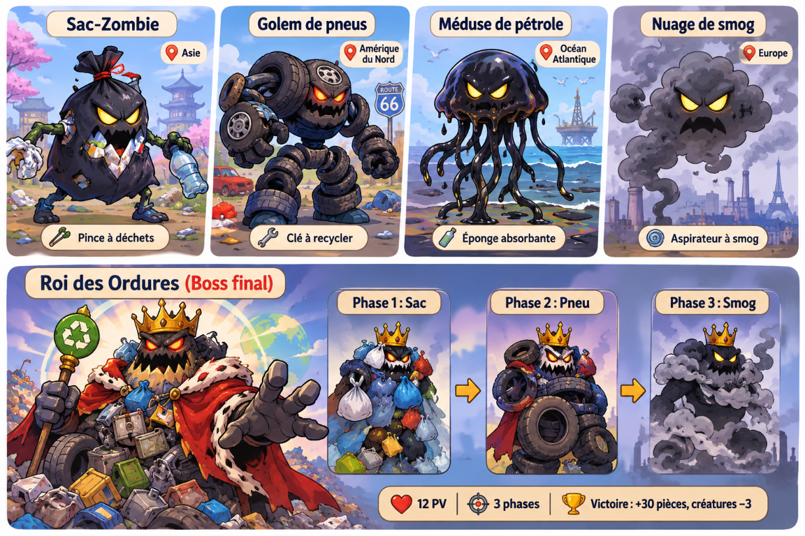

# 17 — Direction artistique et atmosphère

> **Référence** : l'atmosphère de la [planche des ennemis](images/ennemis.png) (arrière-plans, lumière,
> couleurs, cadres). Elle donne le ton de **tout le jeu** : plateau, scènes de BD, carte, menus et
> mini-jeux.

## L'atmosphère en une phrase

> **Un monde de dessin animé peint, lumineux et coloré, abîmé par la pollution, que le joueur rend peu
> à peu à la vie.**

Le jeu doit donner **envie d'agir**, sans faire peur. La pollution est sombre et inquiétante, mais la
lumière et la nature sont toujours présentes quelque part dans l'image. C'est l'**espoir**.

## Style d'illustration

| Aspect | Règle |
|---|---|
| **Rendu** | Illustration 2D **peinte et cartoon** : des formes rondes et généreuses, des contours foncés légers, des ombres douces, une texture légère de peinture |
| **Lumière** | Une source de lumière **chaude** (soleil bas, lever ou coucher) avec des **reflets** brillants. Les créatures ont des yeux qui brillent et ressortent dans le décor. |
| **Ciel** | Un dégradé **bleu clair → lavande / violet doux** avec de gros nuages ronds et blancs. Le ciel est l'élément qui change le plus avec l'état de la planète. |
| **Profondeur** | Des décors en **3 plans** : un premier plan détaillé (sol, déchets ou fleurs), un plan intermédiaire (lieu typique de la région), et un fond flou et clair (silhouette de ville, horizon, la Terre) |
| **Lieux** | Chaque région a un **monument ou paysage reconnaissable**, comme sur la planche : pagodes et cerisiers (Asie), Route 66 (Amérique du Nord), plateforme pétrolière et mouettes (Atlantique), usines et tour Eiffel (Europe) |
| **Personnages** | Des proportions cartoon (grosse tête, yeux expressifs). Ziko et ses alliés ont des **couleurs vives** et les créatures des **couleurs sombres**. Le joueur voit tout de suite qui est qui. |

## Palette de couleurs

Deux palettes s'opposent. **L'image passe progressivement de l'une à l'autre** selon les métriques.

| Palette | Usage | Couleurs (indicatives) |
|---|---|---|
| 🌸 **Nature / espoir** | Ciel sain, végétation, Ziko, l'interface | Bleu ciel `#7EC8F2`, lavande `#B9A7E8`, rose cerisier `#F4A6C8`, vert feuille `#6BBF59`, jaune soleil `#FFD45C`, bleu océan `#2E8FD0` |
| 🏭 **Pollution / danger** | Smog, déchets, créatures, zones polluées | Gris fumée `#6E6E78`, anthracite `#2B2B33`, brun boueux `#7A5C3E`, noir pétrole `#141018` avec reflets bleutés, ocre `#C9A25A` |
| ✨ **Accents** | Yeux des créatures, alertes, récompenses | Jaune brillant `#FFE14D`, rouge vif `#E5483B`, or `#F2B93B` |

Les couleurs des **niveaux de jauge** (critique, alerte, normal, confortable) restent celles de
[07 — Statut](07-statut-et-jauges.md#les-niveaux-de-couleur), avec des teintes ajustées pour aller avec
cette palette.

## Le monde qui change : l'arrière-plan vivant

L'arrière-plan du plateau (voir [06 — Interface](06-interface.md#zone-de-gauche--scène-et-plateau))
utilise ce contraste. Il va du **décor du Nuage de smog** de la planche (ciel gris, usines, fumée) au
**décor du Sac-Zombie**, mais sans les déchets (ciel bleu-lavande, arbres en fleurs) :

| État de la planète | Ciel | Sol et végétation | Détails |
|---|---|---|---|
| 🔴 Critique (départ) | Gris-brun, smog épais, soleil voilé | Terre sèche, déchets, arbres morts | Cheminées qui fument, silhouettes de créatures au loin |
| 🟠 Alerte | Gris-bleu, quelques trouées de lumière | Herbe clairsemée, moins de déchets | Moins de fumée, quelques oiseaux |
| 🟡 Normal | Bleu pâle, nuages blancs | Herbe verte, jeunes arbres | Éoliennes, panneaux solaires, animaux |
| 🟢 Confortable | Dégradé bleu → lavande, lumière dorée | Arbres en fleurs (roses), prairie | Papillons, oiseaux, rivière claire, la Terre qui brille à l'horizon |

Chaque élément du décor dépend d'une métrique : le ciel des **gaz toxiques**, la végétation de la
**biodiversité**, les éoliennes de l'**énergie propre**, les silhouettes des **créatures**, et la mer et
la banquise de la **température**. Le passage d'un état à l'autre se fait **en fondu** (environ 2 s),
pendant le bilan de fin d'année.

## Cadres et interface

L'interface reprend les **cadres de la planche** :

- **Cartes et fenêtres** : un fond **crème / ivoire** (`#FFF6E3`), des **coins très arrondis**, un
  **contour brun foncé** épais (`#4A3426`) et une petite ombre en dessous. On dirait des cartes à
  jouer posées sur le décor.
- **Bandeaux de titre** : une étiquette crème arrondie au-dessus d'une illustration (comme « Sac-Zombie »
  ou « Phase 1 : Sac »).
- **Étiquettes d'information** : une petite pastille crème avec une icône. Par exemple, une **épingle
  rouge** et le nom de la région, ou une icône d'objet et son nom (« Pince à déchets »).
- **Flèches et liens** : des flèches **jaune-orangé** épaisses, comme entre les phases du boss.
- **Boutons d’action** : face jaune dorée éclairée en haut à gauche, reflet fin, tranche ambrée et ombre sous le bouton. Le liseré reste vert, sans feuilles derrière le bouton. Le relief est dessiné en 2D ; il ne change pas la zone tactile.
  La face s’enfonce à l’appui ; l’action se déclenche au relâchement sur le bouton. Sortir du bouton pendant l’appui annule le geste. Les feuilles utilisent une texture commune aux courbes lissées, dessinée en haute résolution.
- **Dialogue et lecture** : bulle ivoire à contour vert, nom sur un cartouche vert et pousse en marge. Le compteur de cases et les consignes restent blancs sur une pastille sombre pour être lisibles sur chaque décor.
- **Bandeau de statistiques** : une ligne d'icônes séparées par des traits verticaux (« ❤️ 12 PV |
  🎯 3 phases | 🏆 Victoire… »). On l'utilise pour les fiches de créatures, d'objets et de projets.
- **Typographie** : une police **ronde et grasse**, très lisible pour les enfants (par exemple *Baloo 2*
  ou *Fredoka*, polices libres de droits). Le texte est brun foncé sur le crème, jamais en noir pur.

Ces cadres sont utilisés partout : cartes d'information de la colonne de droite, fenêtres Carte,
Inventaire et Statut, fiches de créatures, magasin, cases de BD, écran de résultats.

## Application aux autres éléments

| Élément | Atmosphère |
|---|---|
| **Scènes d'ouverture** ([02](02-scenes-d-ouverture.md)) | Elles commencent avec la palette nature (case 1), passent à la palette pollution (cases 3 à 11), puis la lumière dorée revient (cases 13 à 15) |
| **Scènes de jalons** ([08](08-jalons-et-animations.md)) | Un passage visible de la palette pollution vers la palette nature dans le décor de la métrique |
| **Carte du monde** ([09](09-carte-du-monde.md)) | Un planisphère peint au même rendu. Le voile de smog et les couleurs suivent les mêmes palettes. Les points ont la forme d'épingles et de pastilles crème. |
| **Combats** ([12](12-combats.md)) | Le décor de région de la planche, avec la créature au centre et Ziko au premier plan |
| **Mini-jeux** ([11](11-mini-jeux.md)) | Même rendu, mais des décors **plus simples et lisibles** (moins de détails derrière l'action) pour garder la lisibilité et la fluidité |
| **Épilogue** ([15](15-fin-et-score.md)) | La palette finale dépend du résultat : lumière dorée et ciel lavande pour une bonne fin, ciel gris pour une mauvaise |

## Les dessins originaux

Les **dessins manuscrits des notes** (Ziko, le super-héros « S », les icônes des cases, les pièces)
servent de **croquis de référence** pour les formes et les icônes. Ils seront **redessinés** dans le style
ci-dessus. Idée bonus : une **galerie des croquis** à débloquer en fin de partie, qui montre les dessins
d'origine.

## Illustrations peintes (niveau de qualité de référence)

Le **niveau de détail et de finition** visé est celui de la [planche des ennemis](images/ennemis.png) :
rendu peint, lumière chaude, textures, profondeur en 3 plans, contours foncés sur les personnages.

**Ce qui est déjà produit** (dans `public/art/`) :

| Fichier | Contenu |
|---|---|
| `title` | Écran titre : la moitié nature et la moitié polluée, avec la Terre à moitié malade |
| `panel-<décor>` | Les **15 décors de l'intro** : jardin, salon, océan, ville sous le smog, hôpital, canicule, station-service, décharge la nuit, parc attaqué, animaux menacés, 4 catastrophes, chambre, pousse, seuil de la maison, la Terre vue de l'espace |
| `ziko-happy`, `ziko-shocked`, `ziko-sad`, `ziko-back` | Ziko peint (fond transparent) dans 4 poses : joyeux et déterminé, choqué ou en colère, triste ou inquiet, de dos avec une cape |

**Modèle de Ziko** : un garçon de 10 ans aux cheveux bruns bouclés et en bataille, avec un t-shirt vert
orné d'une feuille blanche, un jean avec une pièce au genou, des baskets marron, un sac à dos orange…
et **sa serpillière**. Toute nouvelle pose doit être faite à partir de `ziko-happy` comme référence.

**Comment ajouter une illustration :**
1. Générer l'image en donnant la planche `docs/images/ennemis.png` comme **référence de style** (et une
   image de Ziko pour un nouveau personnage ou une nouvelle pose). Il faut laisser de la place pour
   l'encadré de texte en haut à gauche et pour Ziko en bas d'un côté.
2. La convertir : `python tools/prepare-art.py bg <image.png> panel-<id>` pour un décor, ou
   `python tools/prepare-art.py sprite <image.png> ziko-<pose>` pour un personnage. Le script recadre en
   16:9, produit du WebP en **pleine taille et en demi-taille** (`@small`) et rogne les sprites.
3. La déclarer dans `src/data/art.ts`. Le test `tests/ui/art.test.ts` vérifie que chaque fichier existe
   en deux tailles et que chaque case de l'intro a son décor.

**Filet de sécurité** : si une illustration manque ou n'est pas encore chargée, le jeu affiche une
**version peinte par le code** (`src/ui/paint/`), en dégradés et formes ombrées. Le jeu ne casse donc
jamais.

## Contraintes techniques liées au style

Pour que le jeu reste fluide (voir [16 — Technique](16-technique.md#1-performance--un-jeu-fluide-sans-lag)) :

- Les décors peints sont exportés en **WebP**, en 2 048 px de large au maximum. Les plans sont des
  **calques séparés** (pour la parallaxe et les changements d'état), plutôt qu'une version de chaque
  image entière par état.
- Les personnages et créatures sont regroupés dans des **atlas de textures**. Les reflets et les yeux
  brillants sont des sprites ou des effets légers, pas des filtres coûteux en temps réel.
- La fumée et le smog utilisent un **petit nombre de particules** réutilisées et des textures de
  brouillard qui défilent.
